# 冰汽时代·余烬 (Frostpunk: Embers) - 3D 资产库

本仓库为酒馆 (SillyTavern) 角色卡《冰汽时代·余烬》专属的 3D 建筑模型与高精渲染资源库。

## 🏛️ 模型资产列表

| 建筑设施 | 格式 | 预览图 | jsDelivr 直链 |
| :--- | :--- | :--- | :--- |
| generator.glb | glTF 2.0 Binary | 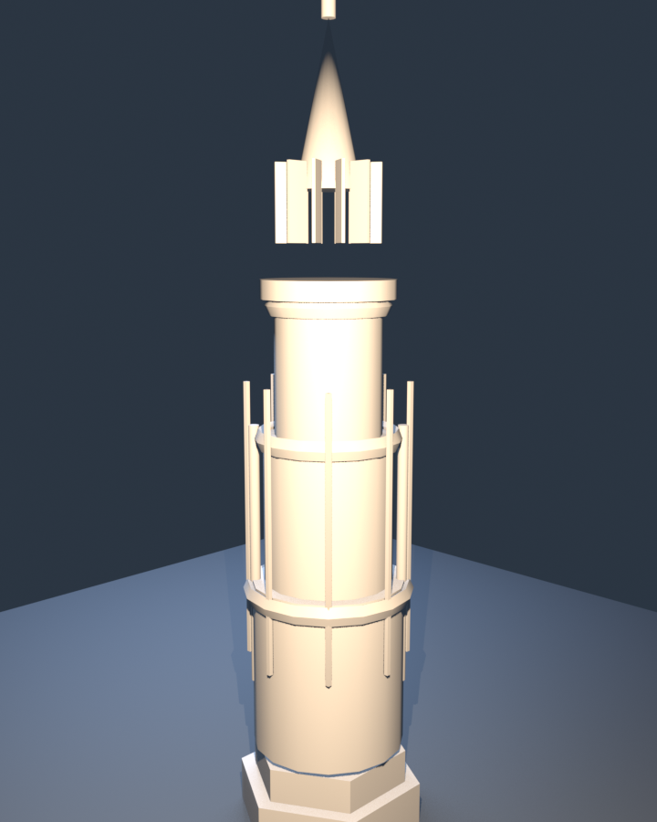 | https://testingcf.jsdelivr.net/gh/Windfarbe/bingqishidai@main/models/generator.glb |
| cookhouse.glb | glTF 2.0 Binary | 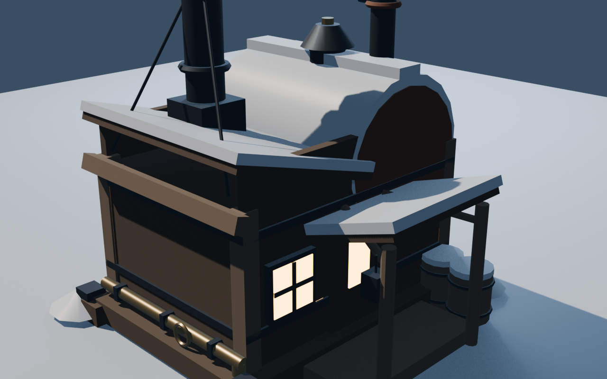 | https://testingcf.jsdelivr.net/gh/Windfarbe/bingqishidai@main/models/cookhouse.glb |
| bunkhouse.glb | glTF 2.0 Binary | 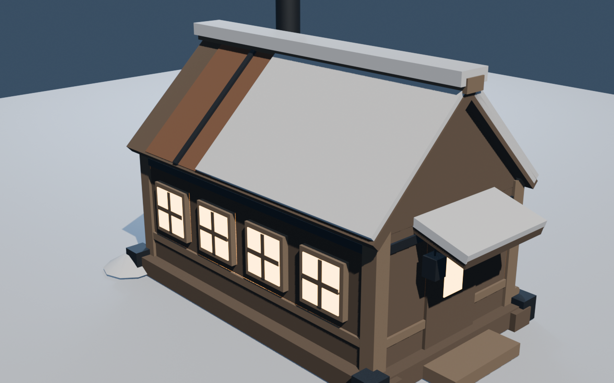 | https://testingcf.jsdelivr.net/gh/Windfarbe/bingqishidai@main/models/bunkhouse.glb |
| clinic.glb | glTF 2.0 Binary | 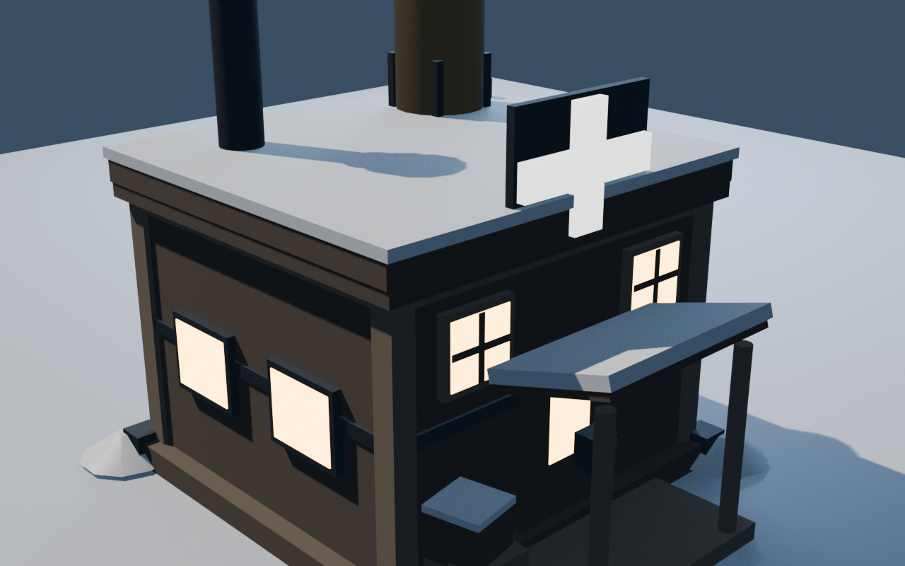 | https://testingcf.jsdelivr.net/gh/Windfarbe/bingqishidai@main/models/clinic.glb |
| hunter_hut.glb | glTF 2.0 Binary | 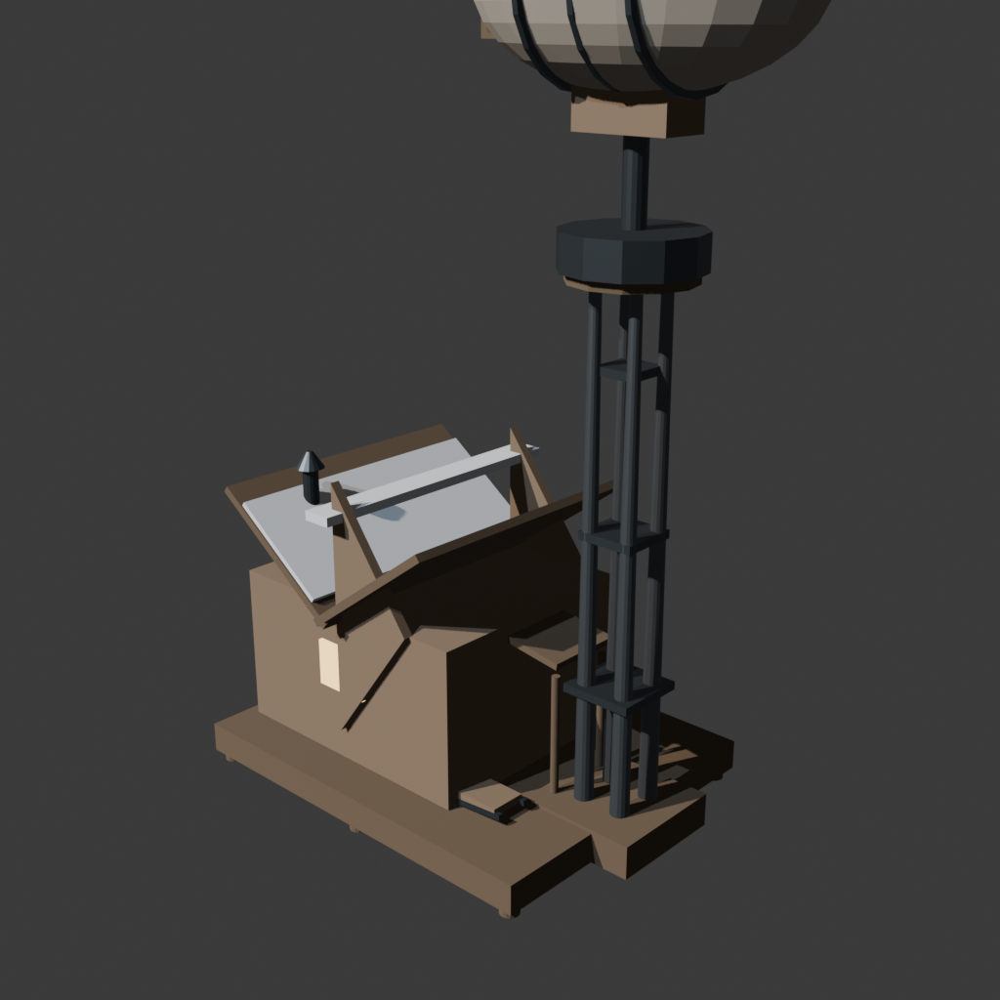 | https://testingcf.jsdelivr.net/gh/Windfarbe/bingqishidai@main/models/hunter_hut.glb |
| workshop.glb | glTF 2.0 Binary | 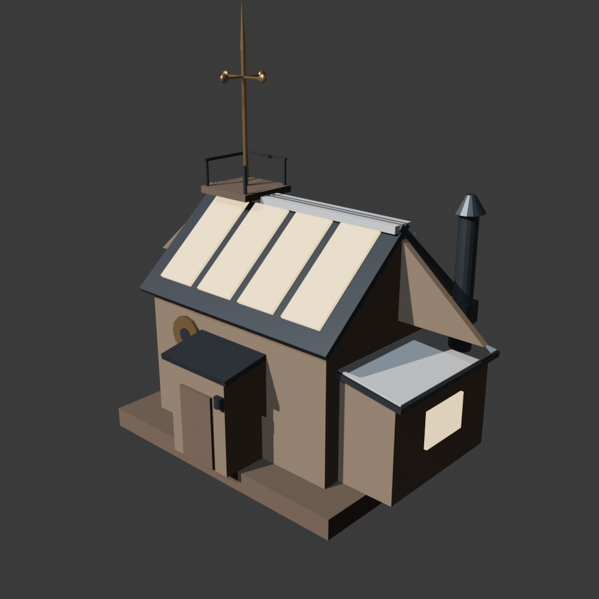 | https://testingcf.jsdelivr.net/gh/Windfarbe/bingqishidai@main/models/workshop.glb |
| coal_thumper.glb | glTF 2.0 Binary | 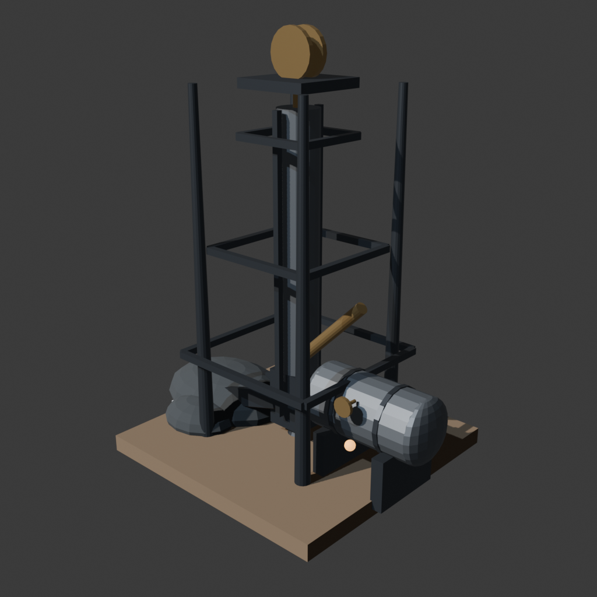 | https://testingcf.jsdelivr.net/gh/Windfarbe/bingqishidai@main/models/coal_thumper.glb |
| beacon.glb | glTF 2.0 Binary | 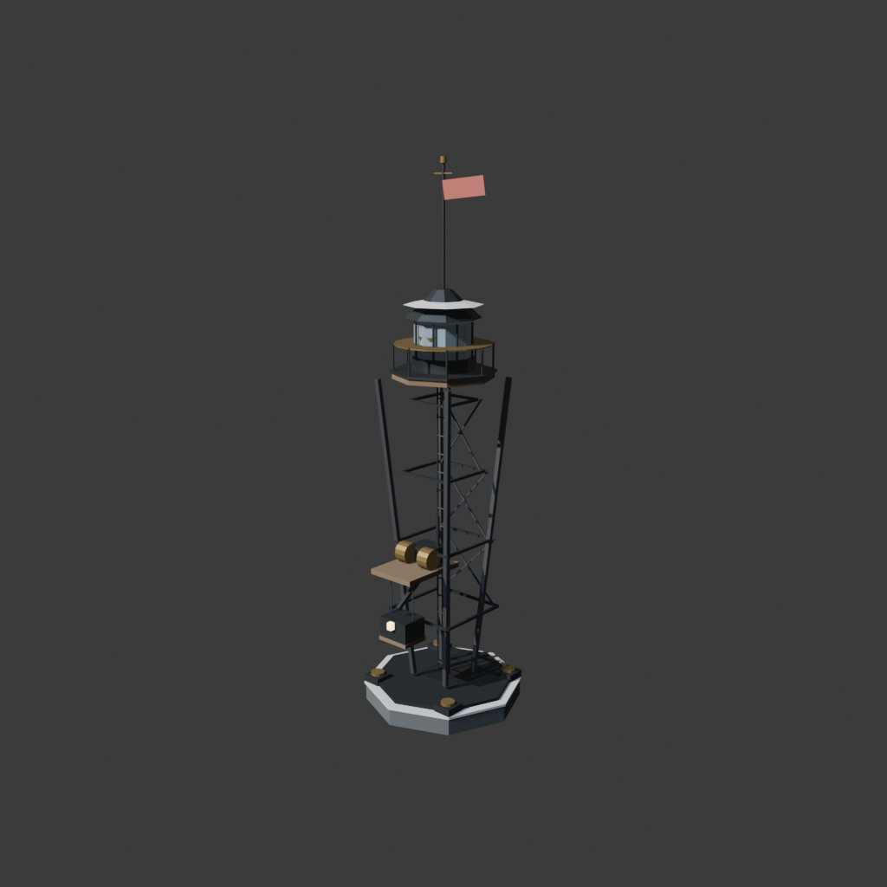 | https://testingcf.jsdelivr.net/gh/Windfarbe/bingqishidai@main/models/beacon.glb |
| resource_depot.glb | glTF 2.0 Binary | 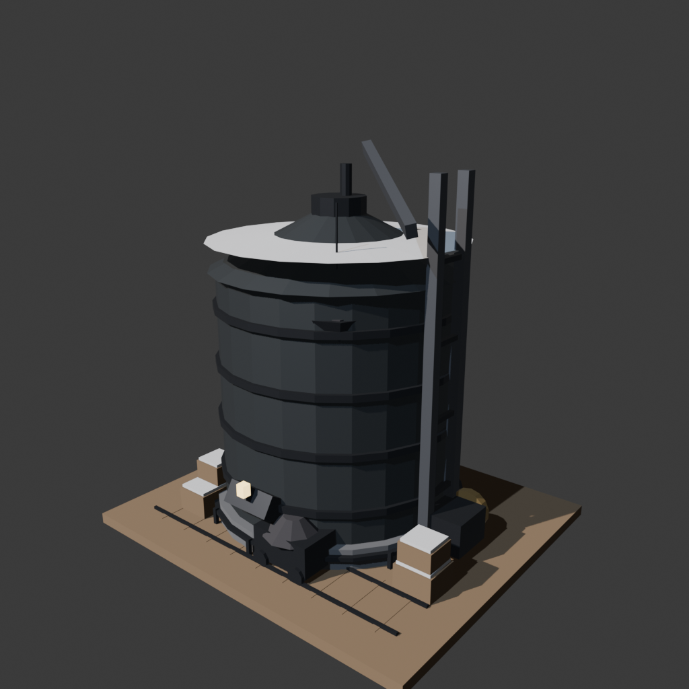 | https://testingcf.jsdelivr.net/gh/Windfarbe/bingqishidai@main/models/resource_depot.glb |
| care_house.glb | glTF 2.0 Binary | 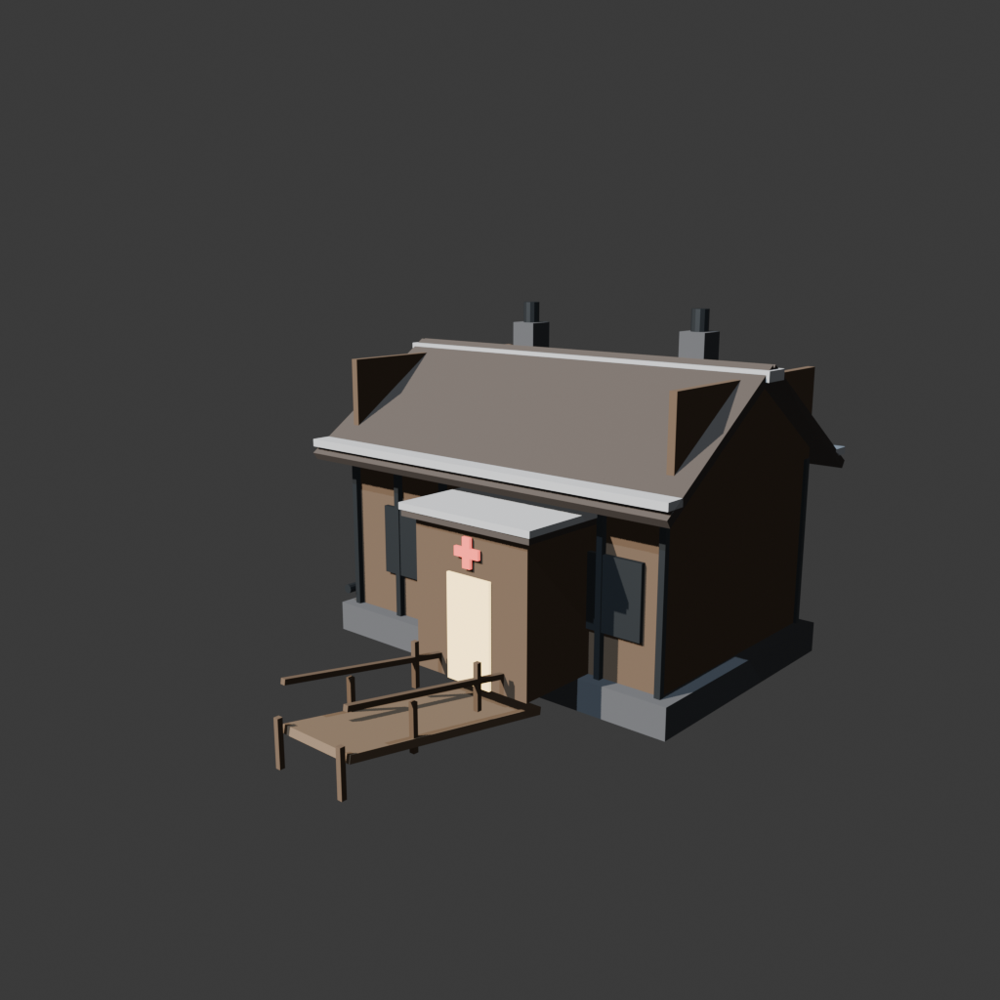 | https://testingcf.jsdelivr.net/gh/Windfarbe/bingqishidai@main/models/care_house.glb |
| sawmill.glb | glTF 2.0 Binary | 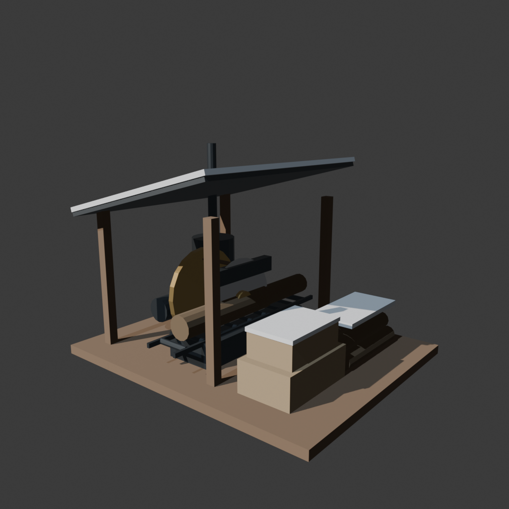 | https://testingcf.jsdelivr.net/gh/Windfarbe/bingqishidai@main/models/sawmill.glb |

---
由 Blender 5.2 程序化建模生成，专供 Three.js / SillyTavern 状态栏嵌入式 3D 城市俯视图使用。
